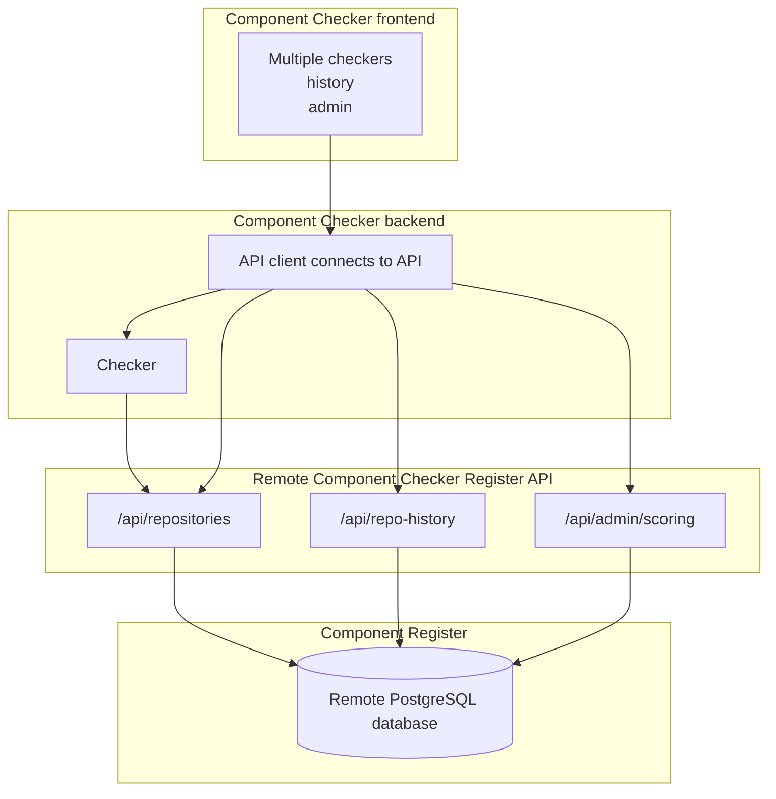
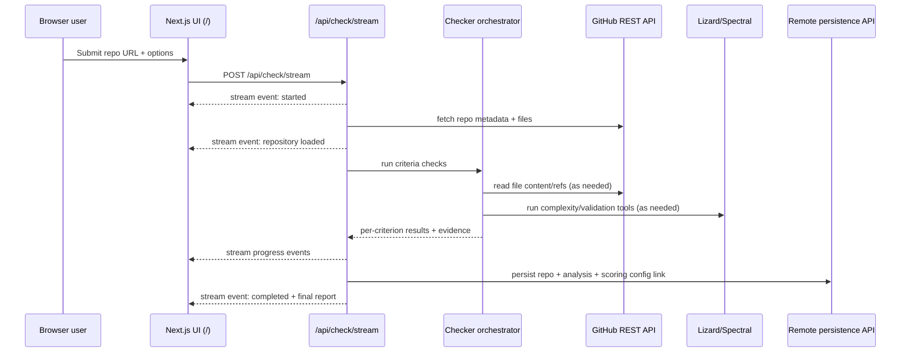

# Common Ground Checker

<p>
	
	
	
</p>

An online automatic compliance checker for [Common Ground](https://commonground.nl) — the Dutch vision and architecture for open, reusable software in municipalities.

## What it checks

Criteria are grouped into five categories. Each criterion has a requirement level (mandatory / recommended / informative) and a configurable weight that influences the overall score.

The rating guide at `/docs` ("Rating guide" in the site navigation) explains per category and aspect what the 1 to 5 star ratings mean, how the checker measures them and which sources they are based on. The content lives in `src/lib/ratingDocs.ts`; every aspect has a stable anchor, `/docs/<category-slug>#<aspect-id>`.

### Governance

| # | Criterion | Level | Standard |
|---|-----------|-------|----------|
| 1 | **OSI-approved open-source license** — LICENSE file with an OSI-approved identifier | Mandatory | [opensource.org/licenses](https://opensource.org/licenses) |
| 2 | **EUPL license preference** — explicit check whether the repository uses the European Union Public Licence | Mandatory | [EU EUPL](https://interoperable-europe.ec.europa.eu/collection/eupl/eupl-text-eupl-12) |
| 3 | **Copyright / IP owner disclosure** — probable owner inferred from legal files and metadata | Recommended | [opensource.guide/legal](https://opensource.guide/legal/) |
| 4 | **publiccode.yml** — government metadata file in the repository root | Mandatory | [Standard for Public Code](https://standard.publiccode.net) |
| 4a | **Maintained** — a valid maintenance contract in publiccode.yml: a contractor with a name and an end date that has not passed | Recommended | [publiccode.yml maintenance](https://publiccodeyml.github.io/v0/schema.core.html#section-maintenance) |
| 5 | **Contributing guide** — CONTRIBUTING file explaining how to contribute | Recommended | [GitHub docs](https://docs.github.com/en/communities/setting-up-your-project-for-healthy-contributions/setting-guidelines-for-repository-contributors) |
| 6 | **Code of Conduct** — CODE_OF_CONDUCT file present | Recommended | [opensource.guide](https://opensource.guide/code-of-conduct/) |

### Architecture

| # | Criterion | Level | Standard |
|---|-----------|-------|----------|
| 7 | **API-first / OpenAPI spec** — machine-readable OpenAPI or Swagger spec present | Mandatory | [API Design Rules](https://commonground.nl/cms/view/54476259/api-designrules) |
| 8 | **NL API Design Rules (ADR) validation** — OpenAPI / API design is validated against the configured Spectral ruleset | Mandatory | [API Design Rules](https://commonground.nl/cms/view/54476259/api-designrules) |
| 9 | **5-Layer Architecture** — component belongs to a recognised Common Ground layer | Recommended | [5-lagen model](https://commonground.nl/cms/view/54476261/5-lagen-model) |
| 9a | **Supported standards**: the standards and versions publiccode.yml declares under `supports`, compared with the OpenAPI files in the repository | Informative | [publiccode.yml supports](https://publiccodeyml.github.io/v0/schema.core.html#key-supports) |

A component can declare its layer in `publiccode.yml` with a `supports` entry. The declaration takes precedence over the heuristics on paths and text. The layer is one of `interaction`, `process`, `integration`, `service` or `data` (the Dutch names are accepted too):

```yaml
supports:
  - id: https://commonground.nl/cms/view/54476261/5-lagen-model#data
```

A component declares a standard and its version the same way, with the official URI of that version as the `id`. `docs/publiccode-profile.md` (also in the rating guide at `/docs/publiccode-profile`) explains every `publiccode.yml` field the checker reads, lists the known standards and gives a complete example.

### Security

| # | Criterion | Level | Standard |
|---|-----------|-------|----------|
| 10 | **Security policy** — SECURITY file with responsible disclosure info | Recommended | [GitHub docs](https://docs.github.com/en/code-security/getting-started/adding-a-security-policy-to-your-repository) |
| 11 | **OWASP Secure Coding** — heuristic static analysis checks for common insecure patterns | Mandatory | [OWASP Secure Coding Practices](https://owasp.org/www-project-secure-coding-practices/) |

### Deployment & Operations

| # | Criterion | Level | Standard |
|---|-----------|-------|----------|
| 12 | **Docker support** — Dockerfile (and optionally docker-compose) present | Mandatory | [Haven](https://haven.commonground.nl) |
| 13 | **🐳 Available Docker image** — published registry image URL provided | Mandatory | [Haven](https://haven.commonground.nl) |
| 14 | **CI/CD configuration** — workflow or pipeline config present for automated builds/deployments | Recommended | [GitHub Actions](https://docs.github.com/en/actions/automating-builds-and-tests/about-github-actions) |
| 15 | **Helm chart (Kubernetes)** — Chart.yaml or K8s manifests present | Mandatory | [Haven](https://haven.commonground.nl) |

### Software Quality

| # | Criterion | Level | Standard |
|---|-----------|-------|----------|
| 16 | **Actual source code** — repository contains real source files, not just documentation or configuration | Mandatory | [commonground.nl](https://www.commonground.nl) |
| 17 | **SBOM** — Software Bill of Materials (SPDX or CycloneDX) published | Recommended | [CISA SBOM](https://www.cisa.gov/sbom) |
| 18 | **Documentation** — README, docs folder, or external docs URL | Mandatory | [irealisatie.nl](https://www.irealisatie.nl/kennis/common-ground) |
| 19 | **Changelog presence** — changelog or release notes file found in the repository | Recommended | [Keep a Changelog](https://keepachangelog.com/en/1.0.0/) |
| 20 | **Test suite** — automated tests or test configuration present | Recommended | [GitHub Actions](https://docs.github.com/en/actions/automating-builds-and-tests) |
| 21 | **Code coverage** — coverage report or badge with at least 80% line coverage | Mandatory | [GitHub Actions](https://docs.github.com/en/actions/automating-builds-and-tests) |
| 22 | **Cyclomatic complexity (Lizard)** — average complexity (AvgCCN) is measured and compared against an admin-configurable threshold | Mandatory | [lizard](https://github.com/terryyin/lizard) |
| 23 | **Code metrics** — repository metrics such as lines of code and function count are collected as informative context | Informative | [commonground.nl](https://www.commonground.nl) |
| 24 | **Semantic versioning** — releases or tags following MAJOR.MINOR.PATCH | Recommended | [semver.org](https://semver.org/) |
| 25 | **Maintainability (ISO 25010)** — unit size, unit complexity, unit interfacing, duplication, module coupling and component structure, each rated from 1 to 5 stars, with an estimated overall maintainability rating | Recommended | [Maintainability model](https://github.com/Software-Improvement-Group/sigridci/blob/main/docs/reference/sig-quality-models.md) |

**Stars:** every criterion also shows 1 to 5 stars. Maintainability has its own scale (4 stars or more passes, 3 stars warns). The other criteria map pass, warn and fail to 5, 3 and 1 stars. The component as a whole and each category also get a rating; see [Ratings](#ratings).

The maintainability analysis runs `scripts/maintainability/check_maintainability.py`, which needs `python3`, lizard 1.24.3 and jscpd 4.0.5. The Docker image installs them. `MAINTAINABILITY_TIMEOUT_SECONDS` (default 600) caps how long one analysis may run. `node scripts/sync-maintainability.mjs [commit]` refreshes the vendored script from its upstream; `scripts/maintainability/UPSTREAM` records the commit.

**Note:** Mandatory criteria are included in the overall score. Recommended criteria still contribute when enabled, while informative criteria are only shown as contextual information and are not used in scoring.

## Getting started

1. Install dependencies

```bash
npm install
```

2. Configure the remote API
```
cp .env.local.example .env
```
Edit .env and set `URL` to the remote API server, e.g. `http://localhost:3000`

Edit `GITHUB_TOKEN` if available

3. Install Lizard (required for cyclomatic complexity criterion)
```
py -m pip install lizard
```

4. Start the development server
```
npm run dev
```

Ensure the remote Component Checker Register API is running at the configured URL.

Open [http://localhost:3000](http://localhost:3000) and paste a GitHub repository URL.

A **GitHub personal access token** in `.env` is optional but strongly recommended — the unauthenticated GitHub API rate limit is 60 requests/hour, which is quickly exhausted for newer repos.

### Scan a local checkout

To check a repository without the web interface, for example in a CI job or before pushing, scan a local git checkout in place:

```bash
npm run --silent scan:local -- <checkout> [--owner O] [--repo R] [--register] [--scoring FILE] [--api-spec PATH]... [--out FILE] [--full]
```

It prints one JSON document with the status of each criterion, the score and the version found. Tracked and untracked files are read (ignores honoured), the best tag reachable from `HEAD` is the version, and the licence comes from the `LICENSE` file. Without `--scoring` the default scoring configuration is used and no API is called; `FILE` is a saved copy of `GET /api/admin/scoring`. `--full` adds the complete report.

A criterion whose tool or service could not run (for example Lizard is not installed) is listed under `unmeasured`: its status says nothing about the checkout. The exit code is 0 when the scan ran and 2 when it could not scan.

## Tech stack

- **Next.js 16 + React 18 + TypeScript** for the app and server API route handlers.
- **Tailwind CSS** for styling.
- **Remote Component Checker Register API** for persistence and scoring configuration.
- **Node.js** runtime for the application and check orchestration.
- **Vitest** for tests and **ESLint** for linting.

## Security scanning

To scan for leaked credentials/secrets locally with Gitleaks:

```bash
# Install Gitleaks once (Windows)
winget install Gitleaks.Gitleaks

# Scan repository history using the local config
npm run security:secrets
```

The scan uses `.gitleaks.toml` and runs with `--redact` so findings are masked in output.

## Tech stack

### Framework and runtime

- **Next.js 16 (App Router)** for UI routes and server API routes in one project.
- **React 18 + TypeScript** for typed UI and domain models.
- **Node.js runtime** for check orchestration and API integrations.

### Data and persistence

- **Remote Component Checker Register API** is responsible for persistence and scoring configuration.
- The local app forwards storage and configuration requests through proxied `/api` endpoints.
- Stored by the remote API:
  - repository metadata and discovered locations
  - per-run analysis results and evidence
  - versioned scoring configurations linked to each run

### UI and developer tooling

- **Tailwind CSS** for styling.
- **Lucide React** for UI icons.
- **Vitest** for tests.
- **ESLint + TypeScript** for static quality checks.

### Analysis dependencies used by checkers

- **GitHub REST API** for repository content, metadata, and refs.
- **Lizard** (Python CLI) for cyclomatic complexity checks.
- **Spectral** (via `npx`) for ADR/OpenAPI style validation use cases.
- **js-yaml** for YAML parsing (`publiccode.yml`, OpenAPI YAML, Helm-related YAML).
- **jsPDF** for client-side PDF export of analysis results.

## Application architecture

The application is built as a single Next.js service with clear layers:

1. **Presentation layer (React pages/components)**
	- Components, the home page (`/` and `/components`, with one page per component: `/components/<owner>/<repo>` shows the latest run in full, `/components/<owner>/<repo>/<analysisId>` the same page for an older run; both graph the overall rating (0.5 to 5.5, pass line at 2.5) of every stored run and list every run with its rating, pass or fail, errors and warnings)
	- Users (`/users` and `/users/<slug>`): the organisations that use a component, as components declare them under `usedBy` in publiccode.yml
	- Providers (`/providers` and `/providers/<slug>`): who offers maintenance, support, hosting, implementation or training for which component, from the `providers` field of `config/repositories.yml`, read when the site is built
	- About (`/about`), with the check form on a server and "Add your component" on the static site (also at `/add-component`)
	- Admin scoring UI (`/admin`, server only)
	- The navigation shows Components, Users, Providers, Rating guide and About, plus Admin on a server. The old paths `/history/...` and `/organisations/...` redirect to `/components/...` and `/users/...`: on a server through `redirects` in `next.config.js`, in the static export through small redirect pages

2. **API layer (Next.js route handlers under `/api`)**
	- Validates input, orchestrates checks, persists results, and serves history/config data.

3. **Domain/checker layer (`src/lib/checkers`)**
	- Independent criterion checkers (license, OpenAPI, Docker, Helm, docs, tests, complexity, OWASP, etc.).
	- A central orchestrator combines checker results into one weighted score.

4. **Integration layer**
	- GitHub API client (`src/lib/github.ts`)
	- External tool invocations (Lizard/Spectral)

5. **Persistence layer**
	- Handled by the remote Component Checker Register API; this app proxies storage and scoring config requests through local `/api` routes.

### Architecture diagram



### Streamed check sequence (`/api/check/stream`)



## APIs

### Internal API endpoints

These local Next.js endpoints either run the checker or proxy storage and configuration requests to the remote Component Checker Register API.

| Method | Endpoint | Purpose |
|---|---|---|
| `GET` | `/api/openapi` | Retrieve the machine-readable OpenAPI specification |
| `POST` | `/api/repositories` | Create or update repository metadata via the remote API |
| `POST` | `/api/repositories/{repoId}/analyses` | Persist a new analysis result for an existing repository via the remote API |
| `PUT` | `/api/repositories/{repoId}/follow` | Follow or unfollow a repository for scheduled rescans via the remote API, forwarding the admin bearer token |
| `POST` | `/api/check` | Run full analysis and persist result through the remote API |
| `POST` | `/api/check/stream` | Stream progress/events during analysis |
| `GET` | `/api/admin/scoring` | Retrieve current scoring configuration from the remote API |
| `POST` | `/api/admin/scoring` | Save new scoring configuration snapshot to the remote API |
| `GET` | `/api/repositories` | List known repositories with latest summary via the remote API; `q` searches owner, name, description, URL and topics |
| `GET` | `/api/repo-history` | Return analysis runs/history for repositories via the remote API |

### Following a repository (Admin)

A component page has a collapsed **Follow this repository (admin)** section. An admin chooses whether to follow the repository and how often it is rescanned (daily, weekly or monthly), and confirms with the backend's admin token (the backend's `ADMIN_TOKEN` environment variable). The token is sent with that one request and is not stored. The Components index marks followed repositories with a **Followed** badge and shows their next check.

Each repository on the Components index is a card: its name with the latest overall rating right behind it, the repository, description and URL, and on the right the number of analyses and the last and next check. Its footer shows whether the latest run **Passed** or **Failed**, the number of failures (the entries of the run's errors block, including an overall rating below 2.5) and of warnings, **Followed**, and the version. The check routes store those counts with each analysis as `issueCounts`. A run stored before endorsements existed shows no status; a run with an endorsement but without stored counts takes its failures from the endorsement's reasons.

### Choosing the branch or release to scan

By default a check scans the released version, chosen in this order:

1. the tag that matches the `softwareVersion` in publiccode.yml on the default branch (with or without a leading `v`);
2. otherwise the newest stable release (drafts, pre-releases and `-rc`-style tags are skipped), and without a release the newest stable semver tag;
3. otherwise the default branch, and the result carries a warning saying no release was found.

`POST /api/check` and `/api/check/stream` accept an optional `ref` to choose otherwise: `default-branch` scans the default branch, `latest-release` skips step 1, and a branch or tag name such as `development` scans that ref. A branch or tag that does not exist is refused with `400`. The checker form has an optional **Branch or tag to scan** field, and the follow section has a **What to scan** setting (released version, default branch, latest release, or a branch or tag) that scheduled rescans use.

The tree, every file read, the clone used by the code tools and the API rules all read the same commit. Each result records `scannedRef`, `scannedRefKind` (why that ref was chosen: `declared-version`, `release`, `tag`, `branch`, `default-branch` or `default-branch-fallback`) and `scannedCommit`, and the result and history pages show it, for example "Scanned: declared version v1.2.2 @ abc1234", "Scanned: latest release v1.2.0 @ abc1234" or "Scanned: main (default branch, no release found)".

### Scans of an unchanged commit

A check first resolves the ref to a commit. When the previous analysis of the repository scanned the same commit, the scan is partial: the checks that depend only on the code are copied from that analysis, and only the checks that depend on the outside world run again. Every criterion has a class in `CRITERION_FRESHNESS_BY_CHECK_ID` (`src/lib/checkers/config.ts`):

- `per-commit`: the same commit gives the same answer. Complexity, duplication, coupling, size, the maintainability estimate, the open track, OWASP patterns, secrets, licences and licence headers, file presence (Dockerfile, Helm chart, documentation, tests, CI), the content of publiccode.yml and the standards cross-check.
- `per-run`: measured on every scan. Known vulnerabilities and the health of the locked dependencies (OSV), the Artifact Hub and Trivy report, OpenSSF Scorecard, project health and SLA times, usage and downloads, whether the Docker image is still in its registry, the maintenance contract's `until` date, the version from the releases and tags, the coverage badges and the NL API Design Rules ruleset. A criterion without a class counts as per-run.

A scan is partial only when the scanned commit, the checklist version, the checker fingerprint (a hash of the checker's own code and its pinned tool versions, written to `checker-fingerprint.json` when the image is built) and the scan settings (the hints, `isRegister` and the complexity thresholds) are all unchanged, and the code checks were measured less than `FULL_SCAN_INTERVAL_DAYS` days ago (default 7). Otherwise every check runs. `full: true` in the request runs every check too.

Each copied result carries `reusedFrom` (`analysisId`, `checkedAt`, `commit` of the scan that measured it). Ratings, the verdict, Maintained and drops are computed from the combined results as usual. Each analysis stores `scanMode` (`full` or `partial`), `scanDurationSeconds`, `toolFingerprint` and `inputsFingerprint`. The run page says "Code unchanged since <date> (commit abc1234): code checks reused, outside-world checks run again", and each reused criterion card is marked reused. A partial scan that reuses every code check does not clone the repository.

### ADR Spectral ruleset source (Admin)

On the **Admin** page, the field **"Spectral ruleset source"** controls which ruleset is used for the **NL API Design Rules** check.

- Supported values:
	- URL (for example: `https://static.developer.overheid.nl/adr/ruleset.yaml`)
	- Local file path (for example: `./rulesets/adr.yaml` or `C:/rulesets/adr.yaml`)
- This value is persisted in `ScoringConfig` and applied to new analyses.
- If the field is empty, the app falls back to the default ADR ruleset URL.
- For local file paths, the file must exist on the machine running the app server (not on a remote end-user browser machine).

### External APIs/services

- **GitHub REST API v3** (authenticated with optional `GITHUB_TOKEN`).
- **Remote Component Checker Register API** for persistence and scoring configuration.

### Request flow (high level)

1. User submits repo URL and options in the checker form.
2. `/api/check` (or `/api/check/stream`) parses owner/repo and loads remote repo context from GitHub.
3. Checker orchestrator runs criteria (parallel where possible).
4. Weighted score is computed using the selected/persisted scoring config.
5. Result + evidence is stored through the remote API and returned to UI.
6. Components and admin pages query internal APIs to show prior runs and config snapshots.

## Scoring

Each check has a configurable **weight** (0–1) set via the Admin page. Weights are stored by the remote API as versioned snapshots; each analysis run is linked to the exact scoring config used.

For the Lizard complexity criterion, the Admin page also stores a configurable
**average cyclomatic complexity threshold** (AvgCCN). The check passes when a
repository’s measured AvgCCN is at or below this threshold.

Score formula:
```
baseScore = round((Σ statusScore × weight) / (Σ weight) × 100)
score     = min(100, baseScore)
```

Status scores: **Pass** = 1.0 · **Warn / Info** = 0.5 · **Fail** = 0.

| Score | Label |
|-------|-------|
| ≥ 80 | ✅ Compliant |
| 50–79 | ⚠️ Partial |
| < 50 | ❌ Non-compliant |

Above the detailed results, the live report and the stored analysis page list
what is missing in two blocks:

- **Errors**: mandatory criteria with status Fail, and an overall rating below
  2.5 (it links to the overall rating), so the count matches the reasons the
  component does not pass.
- **Warnings**: recommended criteria with status Fail or Warn, and mandatory
  criteria with status Warn (present but incomplete).

Informative criteria and results with status Info appear in neither block. Each
entry links to its result card, which opens when followed.

## Ratings

Next to the 0-100 compliance score, every analysis gets an **overall rating**, a **rating per category** and a **rating per aspect**, on a continuous scale from 0.5 to 5.5 shown as 1 to 5 stars (for example ★★★☆☆ 3.4). The overall rating is the headline of a report.

Each category consists of aspects, defined in `src/lib/aspects.ts`:

| Category | Aspects |
|---|---|
| Governance | licensing, ownership, community documents |
| Security | vulnerabilities, dependency freshness, activity, licences and management, secrets, secure coding, supply chain |
| Architecture | API, layering (shown, not counted) |
| Maintainability | analysability, modifiability, testability, modularity, reusability, testing |
| Deployment & Operations | containerisation, release management |

- **Criterion rating:** the criterion's continuous rating when it has one, otherwise its stars, otherwise its status: pass = 5.5, warn = 3, fail = 0.5, the ends and the middle of the scale. Mandatory and recommended criteria count with their criterion weight; informative criteria, criteria with weight 0 and results that were not measured (`info`) are left out.
- **Aspect rating:** the weighted mean of its criteria. Some aspects are rated by a check itself, such as the maintainability sub-characteristics. A document-count aspect (community documents, containerisation) rates the share of its documents that pass: all 5.5, at least 80% 4, 60% 3, 40% 2, otherwise 1, and shows the count, for example "4 of 5".
- **Category rating:** the mean of its rated aspects.
- **Overall rating:** the weighted mean of the rated categories with the category weights. Categories with weight 0 don't count.

Ratings are rounded to one decimal; stars round x.5 up. A component is **suitable for Common Ground** (it passes) when no mandatory criterion fails, its overall rating is at least 2.5, publiccode.yml declares a valid maintenance contract, and the rating of the maintainability estimate is at least 3.5, which is 4 stars: the level at which SIG and TÜViT certify maintainability. A scan without a maintainability rating does not pass ("Maintainability not measured"); a lower one gives the reason "Maintainability below 4 stars" with the measured value. The overall rating itself is unchanged by this condition. Analyses stored before ratings existed are rated from their stored results with the active scoring config.

A component is **approved**, the level above suitable, when it is suitable for Common Ground, the scanned publiccode.yml declares `developmentStatus: stable` (only stable components can be approved), the scanned publiccode.yml names at least `MIN_USERS` organisations under `usedBy` (default 2, a proposal), and an SLA is valid. Each scan sends the `usedBy` names to the backend, which stores them and their number; the repository page graphs the number over time. A name counts once, compared case-insensitively and trimmed. An admin records an SLA (party such as VNG, maintainer, start, until and an optional link) on the repository page. An SLA is valid up to and including its `until` day. When a level is not reached the page says why, for example "development status is beta, only stable components can be approved", "1 of 2 users declared in publiccode.yml", "No SLA" or "SLA expired on 2026-06-30". Usage never gives stars and never counts in a rating.

The live report and the stored analysis page show the rating of one component from top to bottom: the overall rating with whether it passes (and why not) and the compliance score, the errors and warnings blocks, and then one section per category. Each category and aspect title links to its page in the rating guide. Every aspect has a bar from 0.5 to 5.5 with marks where the stars change (1.5, 2.5, 3.5 and 4.5), and under it a table of what the aspect is made of:

- **Measured aspects** (the maintainability sub-characteristics): the measured share per property, language and bound, against the thresholds for 5, 4, 3 and 2 stars, and the stars it earns. A check provides these in the `measurements` field of its result; for maintainability they come from the analysis script's report, including its `bands`.
- **Document aspects:** one row per document, found or missing.
- **Other aspects:** one row per criterion with its status and stars, linking to its result card.

The PDF export lists every aspect with its rating.

## Maintenance made measurable

These results are informative. They give no stars and do not count towards the verdict. Every term and target below is a proposal until a governance decision sets it; the backend's scoring configuration holds the values in effect.

- **Drops.** The backend compares each stored run with the previous run of the same kind of version. A criterion that goes from pass to fail, a rating that loses a star, or the lost verdict is a drop, with a fix-by date. The repository page lists the open drops, overdue first; the Components index shows how many are open and overdue.
- **KPI targets.** The project health metrics (CHAOSS) show a proposed target and whether the value meets it.
- **SLA times for issues.** With a `GITHUB_TOKEN`, project health measures the open issues and the issues closed in the last 90 days, in working days (Monday to Friday, Europe/Amsterdam, without the Dutch national public holidays; Bevrijdingsdag counts every year, as in the cao Rijk). Response is the first comment by an owner, member or collaborator, or the first label set by someone other than the author; bots do not count. A fix is dated by the first stable release after the pull request or commit that closed the issue, or by closing the issue as completed when no closing change is known; the result says how many of each.

| Category | How it is recognised | Respond within | Fix within |
|---|---|---|---|
| Critical or high vulnerability | Published GitHub security advisory | not measured | 7 or 30 days, from draft to publication |
| Blocking bug | `blocker`, `critical` or `priority: critical`, only where a repository uses them | 2 | 10 |
| Other bug | `bug`, or issue type Bug | 5 | the next stable release |
| Question, documentation, feature request | `question`, `documentation`, `enhancement`, or issue type Feature or Task | 10 | no fix term |
| Unclassified | no known label | 10 | no fix term |

`duplicate`, `invalid` and `wontfix` keep the response term but have no fix term. A followed repository can add its own labels (`slaLabels` on the backend's follow route); scheduled scans pass them to `/api/check`. Unpublished advisories and Dependabot alerts need admin rights and are not measured.

> **Note:** Automated analysis is indicative only. Architecture checks rely on heuristics. For official certification, contact [commonground.nl](https://commonground.nl).

## License

Copyright © 2026 VNG Realisatie

This project is licensed under the **European Union Public Licence v. 1.2 (EUPL-1.2)**. See [LICENSE](LICENSE) for the full text.

## Static site

The checker can also run without a server or database: a nightly workflow scans the components in `config/repositories.yml`, writes JSON files to the `data` branch and publishes a static export. See `/docs/run-without-a-server` in the app, `npm run scan:static`, `npm run build:static` and `.github/workflows/static-site.yml`. Try it with the sample data: `CGC_DATA_DIR=examples/static-data npm run build:static`, then serve `out/`.
